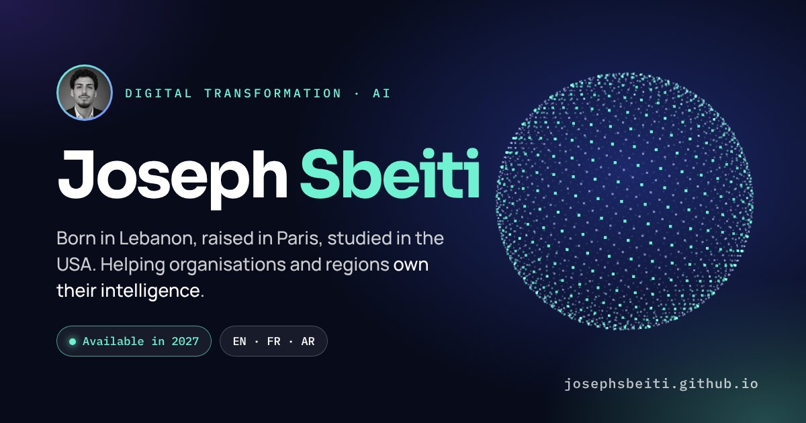

# Joseph Sbeiti · Portfolio

**Live:** [josephsbeiti.github.io](https://josephsbeiti.github.io)

Born in Lebanon, raised in Paris, studied in the USA. Digital transformation and AI: helping organisations and regions own their intelligence. Available in 2027, open to relocation.

## What's inside

- **Origin and purpose:** equal chances in real numbers (France, Lebanon, Mexico, Ivory Coast).
- **Journey:** Paris → Lille → Raleigh → Beirut → Raleigh → Paris → ?
- **MegaMind HQ:** a neural network trained live in the browser and a digital twin of a robot exploring a building.
- **Lab:** International Signature (a full platform built end to end), energy development profiles (k-means, 164 countries) and Joseph OS.
- **Mini Joseph:** a small cartoon guide you can chat with.

Single self-contained `index.html`, no framework, hosted on GitHub Pages.

[CV (PDF)](Joseph-Sbeiti-CV.pdf) · [LinkedIn](https://www.linkedin.com/in/joseph-sbeiti/) · josephsbeiti@gmail.com
